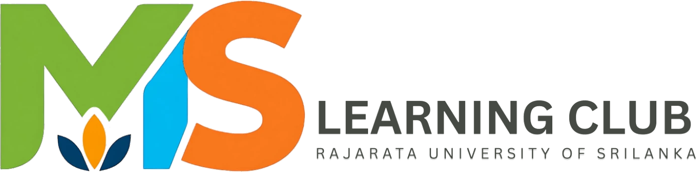
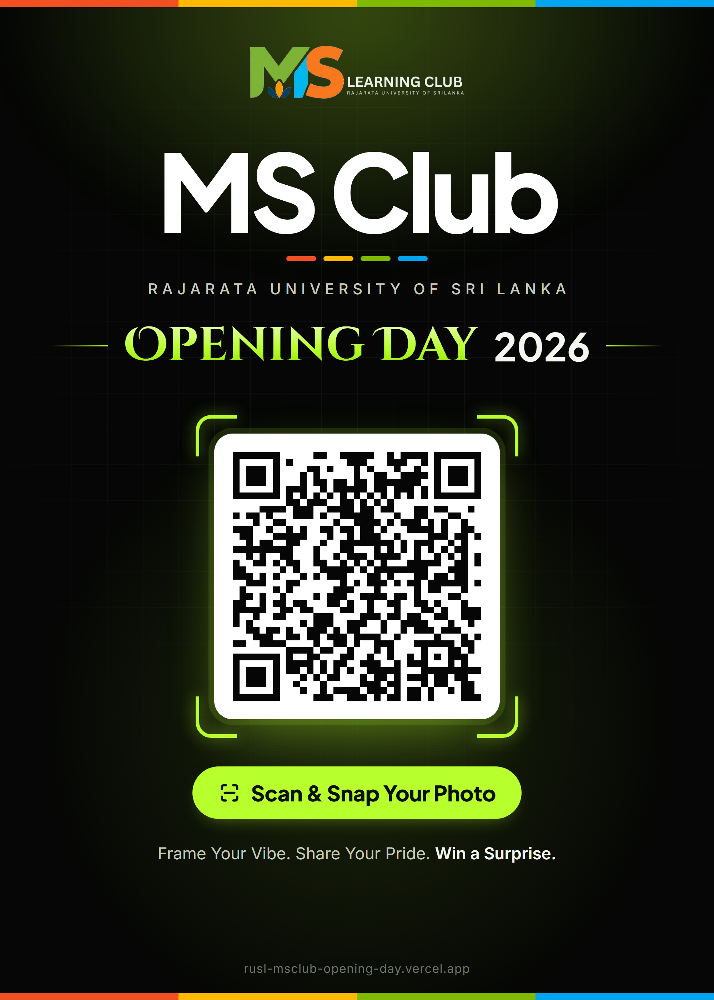

<div align="center">

<picture>
  <source media="(prefers-color-scheme: dark)" srcset="assets/logo.png" />
  
</picture>

# MS Club Opening Day 2026 · Photo Booth

**Frame Your Vibe. Share Your Pride. Win a Surprise.**

A web photo booth built for the **MS Club Opening Day 2026** at **Rajarata University of Sri Lanka**.
Guests scan a QR code, take a photo, get it framed instantly, and share it in seconds.

[](https://rusl-msclub-opening-day.vercel.app/)


</div>

---

## 📱 Event QR Poster

The official poster displayed at the **MS Club Opening Day 2026** venue. Guests scan this QR code to open the photo booth.

<div align="center">



</div>

---

## ✨ Features

| | Feature | Details |
|---|---|---|
| 📸 | **In-browser camera** | Front/back camera switch, 3-second countdown, shutter flash |
| 🖼️ | **Instant framing** | 1080 × 1350 (4:5) branded frame drawn on `<canvas>` in MS Club colours |
| ⬇️ | **One-tap download** | High-quality JPEG saved straight to the device |
| 📤 | **Native share** | Web Share API sends the photo to WhatsApp, LinkedIn, Facebook, Instagram and more |
| 🔗 | **Follow links** | Quick links to the club's LinkedIn, Facebook and WhatsApp channel |
| 🖼️ | **Gallery fallback** | Upload an existing photo, or open the phone's own camera if browser access is blocked |
| 🎉 | **Delightful touches** | Colour-sweep heading, animated viewfinder, confetti on finish |
| 📐 | **No-scroll layout** | Every screen fits the viewport on phones and desktops |
| ♿ | **Accessible** | Respects `prefers-reduced-motion`, has semantic markup and labelled controls |
| 🔒 | **Private by design** | Photos never leave the device. There is no server, upload or storage |

---

## 🧭 How It Works

```
 ┌──────────┐     ┌──────────────┐     ┌──────────────┐     ┌──────────────────┐
 │ Scan QR  │ ──▶ │  Take photo  │ ──▶ │ Auto-framed  │ ──▶ │ Download / Share │
 │ (poster) │     │(getUserMedia)│     │  (<canvas>)  │     │ (Web Share API)  │
 └──────────┘     └──────────────┘     └──────────────┘     └──────────────────┘
```

1. **Home**: guests tap **Take a Photo**, or upload one from the gallery.
2. **Camera**: a live square viewfinder with a timer and camera flip. The selfie is mirrored, just like a real mirror.
3. **Result**: the photo is cropped to a square and placed inside the event frame. Guests can download it, share it, or retake it.

---

## 🎨 Design

| Element | Choice |
|---|---|
| Site theme | Black `#050605` with lime accent `#b8ff2e` |
| Frame palette | MS Club colours: 🟥 `#F25022` 🟩 `#7FBA00` 🟦 `#00A4EF` 🟨 `#FFB900` |
| Headings | **Plus Jakarta Sans** (MS Club) · **Cinzel Decorative** (Opening Day) |
| Body / UI | **Inter** · **Outfit** (frame text) |

The photo frame carries the club logo, the club colours, and a centred "Club Opening Day · RUSL 2026" title.

---

## 🗂️ Project Structure

```
.
├── index.html            # Markup for the three screens (home, camera, result)
├── styles.css            # Theme, layout and animations
├── app.js                # Camera, frame rendering, download/share, confetti
├── vercel.json           # Camera permissions policy header
├── assets/
│   ├── logo.png          # Club logo (for dark backgrounds)
│   ├── logo-light.png    # Club logo (for light backgrounds)
│   └── logo-mark.png     # "MS" mark, used as favicon
└── downloads/
    └── MSClub-OpeningDay-2026-QR.png   # Event QR poster
```

---

## 🚀 Getting Started

No build tools or dependencies are needed. It's a plain static site.

```bash
git clone https://github.com/Mihiran-Thilakarathna/rusl-msclub-opening-day.git
cd rusl-msclub-opening-day
npx serve .
```

Then open **http://localhost:3000**.

> Browsers only allow camera access on `localhost` or `https://`. Opening `index.html` directly from the file system won't work.

---

## ☁️ Deployment

The site is deployed on **[Vercel](https://vercel.com)**, and every push to `main` redeploys automatically.

To deploy your own copy:
1. Import the repository into Vercel.
2. Leave the framework preset as **Other**, with no build command and no output directory.
3. Click **Deploy**.

---

## 🛠️ Customisation

| What | Where |
|---|---|
| Frame colours, size and layout | `FRAME` object and `drawFrame()` in [`app.js`](app.js) |
| Share message and hashtags | `SHARE_TEXT` in [`app.js`](app.js) |
| Downloaded file name | `FILE_NAME` in [`app.js`](app.js) |
| Site colours and fonts | CSS variables in `:root` in [`styles.css`](styles.css) |
| Social links | `.social` block in [`index.html`](index.html) |

---

## 🌐 Connect with MS Club

<div align="center">

[](https://www.linkedin.com/company/ms-club-rajarata-university-of-sri-lanka)
[](https://www.facebook.com/profile.php?id=61568492710655)
[](https://whatsapp.com/channel/0029Vb6B2Qf8KMqcjGJEsx2k)

</div>

---

<div align="center">

Made with 💚 for **MS Learning Club** · Rajarata University of Sri Lanka

Developed by **[Mihiran Thilakarathna](https://github.com/Mihiran-Thilakarathna)**

</div>
